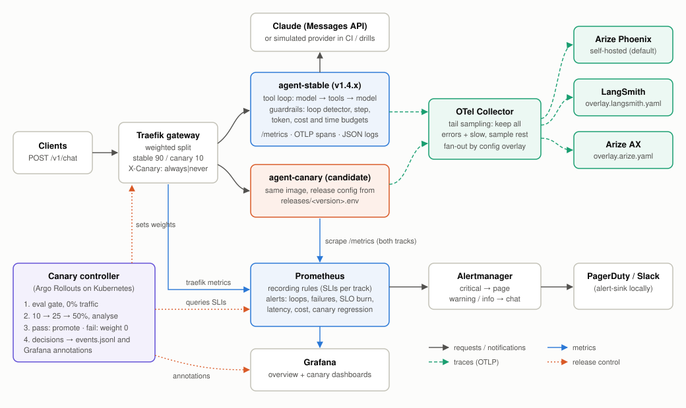
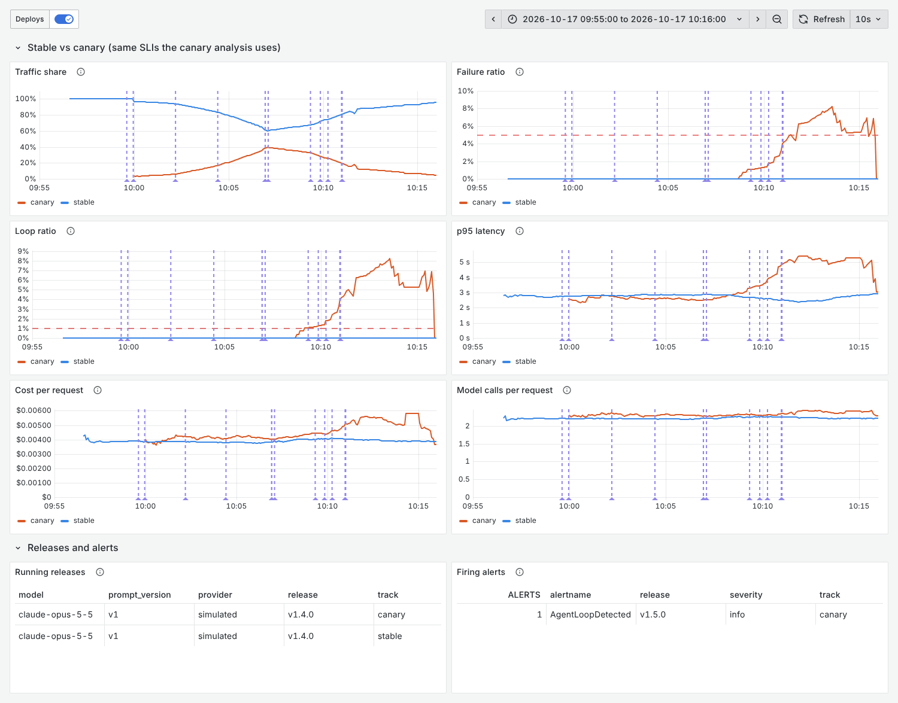
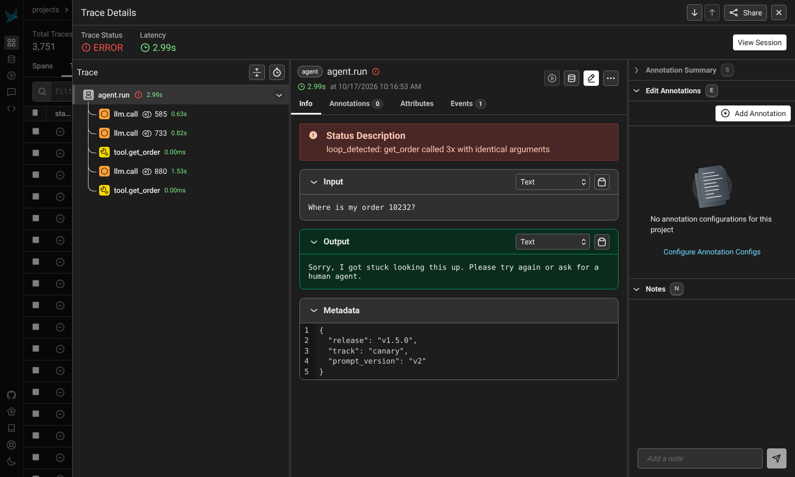

# Production Agent with Observability

A tool-using Claude support agent shipped like a production service, not a notebook:
OpenTelemetry tracing to **Arize Phoenix**, **LangSmith** or **Arize AX**; Prometheus
**latency, cost and token metrics** with Grafana dashboards; **alerts on loops, failures,
SLO burn and spend**; **canary releases** gated on evals and live agent metrics; and
**automatic rollback**. The whole stack runs locally with one command; the same policy runs
on Kubernetes with Argo Rollouts.



## Results

One scripted drill (`make drill`) under continuous load: 3 req/s for 19 minutes, 3,482
requests, on the **simulated provider** ([ADR 0005](docs/adr/0005-simulated-provider.md)). Every
number below is in [`docs/results/drill-2026-10-17.md`](docs/results/drill-2026-10-17.md),
generated from Prometheus, the controller's event log and the notifications Alertmanager delivered.

| # | What was shipped | Gate that decided | Outcome | Time | Customer requests on the bad release |
|---|---|---|---|---|---|
| 1 | `v1.4.1` good (effort low, 6 steps) | eval gate 20/20, then 10 → 25 → 50% all checks pass | **promoted** | 7m20s | n/a |
| 2 | `v1.5.0` bad (prompt v2), eval gate skipped | 10% step: failure ratio 8.34% (limit 2%), loop ratio 8.35% (limit 1%), p95 6.11s vs stable 2.37s, cost/request +75% | **automatic rollback**, traffic off in 1.18s | 2m15s at 10% | 72 total for both attempts, 7 of them looped |
| 3 | `v1.5.0` again, with the eval gate as first written | gate passed at exactly 95% (one looping case), then a still-firing alert failed it at 10% | **automatic rollback** | 43s at 10% | (in row 2) |
| 4 | `v1.5.0` again, after the gate fix | eval gate: 95% pass but 1 guardrail trip, now a hard fail | **rejected before traffic** | 31s | 0 |
| 5 | manual `make rollback` of stable `v1.4.1` → `v1.4.0` | n/a | stable reverted, no failed requests | 36s | n/a |

Stable served 3,061 requests across the drill with **0 failures**, including through the promotion and
the manual rollback (both swap releases without dropping requests).



*Stable (blue) vs canary (orange). From left: the good canary ramping to 50% and being promoted
(~10:07), then the bad one: loop ratio, failure ratio, p95 and cost per request all jump at 10%
traffic, and the traffic share drops back as it is rolled back. Purple markers are the controller's
deploy annotations.*

### What the drill found, and what changed

- **The eval gate alone let the bad release through** (row 3): 19/20 golden cases passed, the one loop
  was within the 95% threshold. Now any guardrail trip on a golden case blocks the release; the same
  release was then stopped before traffic (row 4).
- **A leftover alert from the first attempt failed the second one.** Correct here, but it would also
  have failed an unrelated next release. The controller now only counts alerts for this canary's
  release raised after it started, and per-release alerts stop once the release is no longer running.
- **The page arrived 93 s after the automatic rollback.** Canary alerts now go to chat (the controller
  remediates); only stable pages a human. `make test-rules` asserts that routing.
- **The dashboards showed a phantom 2× on stable during the promotion** (per-release ratios summed per
  track). Fixed by computing per-track ratios from raw counters.
- **Cost per request is a noisy gate at low traffic:** the good canary ran +14% over stable at the 10%
  step (limit +20%) on ~40 requests, because the simulated traffic mix varies. Longer steps or a
  traffic-mix-adjusted comparison would tighten it; the threshold was left as is.

## What's in the box

| Concern | How | Where |
|---|---|---|
| Agent | Claude (`claude-opus-5-5`, effort per release) with 4 strict-schema tools (order lookup, policy search, calculator, ticket); own loop, append-only history, prompt caching, server-side refusal fallback | `agent/runner.py`, `agent/llm/anthropic_client.py`, `agent/tools.py` |
| Guardrails | Loop detector (identical calls, A-B-A-B cycles), step / token / USD / wall-clock budgets; each trip is a labelled outcome | `agent/guardrails.py`, [ADR 0003](docs/adr/0003-loop-detection-and-outcomes.md) |
| Tracing | One trace per request (`agent.run` → `llm.call` → `tool.*`), OpenInference + GenAI semconv + LangSmith attributes; Collector with tail sampling fans out to Phoenix / LangSmith / Arize AX | `agent/telemetry/tracing.py`, `deploy/otel-collector/`, [ADR 0001](docs/adr/0001-otel-collector-fan-out.md), [ADR 0006](docs/adr/0006-sampling-and-content.md) |
| Metrics | Requests by outcome, latency histograms, steps/request, tokens by type, USD cost, tool calls, guardrail trips, refusals, fallbacks; every series labelled `release` and `track` | `agent/telemetry/metrics.py`, `deploy/prometheus/rules/recording.yml` |
| Dashboards | *Agent overview* (SLOs, latency, cost, tokens, cache hit ratio, behaviour, error budget) and *Agent canary analysis* (stable vs canary on every gate), deploy annotations | `scripts/build_dashboards.py` → `deploy/grafana/dashboards/` |
| Alerting | 13 rules: loop detected / loop rate, step budget, failure rate, multi-window SLO burn, provider errors, target down, p95, spend/hour, unpriced model, canary failure and cost regressions; unit-tested with promtool; stable critical → page, canary and warning/info → chat (routing asserted with amtool) | `deploy/prometheus/rules/alerts.yml`, `deploy/prometheus/tests/`, `deploy/alertmanager/`, [RUNBOOK](docs/RUNBOOK.md) |
| Canary | Eval gate at 0% traffic (≥95% pass, zero guardrail trips) → 10 → 25 → 50% with analysis vs stable (failure ratio, loop ratio, p95, cost/request, this canary's critical alerts) → promote or roll back | `canary/`, `evals/`, [ADR 0004](docs/adr/0004-canary-gates.md) |
| Rollback | Automatic on any failed gate (traffic to 0% first); `make rollback` aborts a canary or reverts stable to the previous release with no dropped requests | `canary/controller.py` |
| Kubernetes | Argo Rollouts `Rollout` + `AnalysisTemplate`s (same thresholds, checked by a test), ServiceMonitor, generated PrometheusRule, HPA on in-flight requests, PDB | `deploy/k8s/` |
| CI/CD | Lint, unit tests, promtool, kustomize + kubeconform (CRDs included), full-stack smoke test; tag → GHCR image; manual deploy workflow (ship / rollback) | `.github/workflows/` |

## Run it

Prerequisites: Docker with Compose, [uv](https://docs.astral.sh/uv/), `jq` (for `make ask`).

```bash
make install       # .venv with the package and dev tools
make build         # agent image
make up            # agent stable + canary, Traefik, OTel Collector, Phoenix, Prometheus, Alertmanager, Grafana
make ask Q="Can I return order 10231?"
make load RPS=3 DURATION=600      # traffic for the dashboards
```

| | |
|---|---|
| Agent API | http://localhost:8080/v1/chat |
| Grafana | http://localhost:3000 (anonymous viewer; admin/admin) |
| Phoenix (traces) | http://localhost:6006 |
| Prometheus / Alertmanager | http://localhost:9090 / http://localhost:9093 |
| Notifications sent | http://localhost:9095 |
| Traefik | http://localhost:8090 |

By default the agent runs on a **simulated model** (no key, no spend; see
[ADR 0005](docs/adr/0005-simulated-provider.md)). To use Claude:

```bash
cp .env.example .env    # set LLM_PROVIDER=anthropic and ANTHROPIC_API_KEY
docker compose up -d --force-recreate agent-stable agent-canary
```

To send traces to LangSmith and/or Arize AX as well as Phoenix, set the keys in `.env` and pick an
overlay: `OTEL_OVERLAY=overlay.langsmith.yaml` (or `overlay.arize.yaml`, `overlay.all.yaml`), then
`docker compose up -d otel-collector`.

## Ship and roll back

```bash
make canary RELEASE=v1.4.1   # eval gate → 10 → 25 → 50% → promote, or automatic rollback
make status                  # stable / canary release and traffic split
make rollback                # abort the canary, or revert stable to the previous release
make drill                   # the scripted drill behind the Results section (~15 min)
```

A release is `releases/<version>.env`: prompt version, model, effort and guardrail limits.
Three are included: `v1.4.0` (baseline), `v1.4.1` (effort `low`, fewer steps: a good change)
and `v1.5.0` (prompt v2, "re-check whenever you are not completely certain": a bad one).

On Kubernetes, see `deploy/k8s/kustomization.yaml` for prerequisites and the **deploy** workflow
for ship/rollback; the runbook covers both paths.

## Trace

Each request is one trace: the agent span with the customer message, answer, outcome, total
tokens and cost; one LLM span per model call with model, token counts (including cache reads)
and cost; one tool span per tool call with arguments and result. Guardrail trips appear as an
event on the root span, with the span marked as an error.



*A request on the bad canary: two `get_order` calls, the third identical one refused by the loop
detector, the customer gets a fallback answer, the trace is kept by tail sampling because it is an
error. Phoenix's own "cost" column reads $0 because it prices from its own model table; cost here
comes from Prometheus (`agent_llm_cost_usd_total`) and the `llm.cost.total` span attribute.*

The *Agent overview* dashboard for the same window: [`docs/img/grafana-overview.png`](docs/img/grafana-overview.png).

## Development

```bash
make check       # ruff, pytest (44 tests), promtool rule tests, amtool routing tests
make generated   # rebuild dashboards and the k8s PrometheusRule after changing rules/panels
```

`tests/test_policy_sync.py` fails if the Argo Rollouts thresholds drift from `canary/policy.yaml`,
or if the generated dashboards / PrometheusRule are stale.

## Decisions

- [ADR 0001: OpenTelemetry and a collector, not vendor SDKs](docs/adr/0001-otel-collector-fan-out.md)
- [ADR 0002: The agent owns its loop](docs/adr/0002-own-agent-loop.md)
- [ADR 0003: How loops are detected, and why every non-success counts against the SLO](docs/adr/0003-loop-detection-and-outcomes.md)
- [ADR 0004: Canary gates on agent-level signals, with an eval gate before traffic](docs/adr/0004-canary-gates.md)
- [ADR 0005: A simulated model provider for CI, load tests and drills](docs/adr/0005-simulated-provider.md)
- [ADR 0006: Tail sampling, and what content leaves the process](docs/adr/0006-sampling-and-content.md)

## What was and wasn't verified

- **Run end to end here:** the compose stack, Phoenix ingesting the traces, Prometheus rules and
  alerts, Alertmanager routing, the canary controller's promote / automatic rollback / manual
  rollback paths, the eval gate, and the Grafana dashboards, all with the simulated provider.
- **Checked but not run against a live system:** the Kubernetes manifests render with kustomize and
  pass kubeconform strict validation, CRDs included; they were not applied to a cluster. The
  LangSmith and Arize AX collector overlays and the Claude client were not exercised against live
  accounts (no credentials in this environment).
- **Not claimed:** anything about Claude's answer quality on this task. All numbers above come from
  the simulator, so they show how the delivery pipeline behaves and how fast, not how good the agent is.

## License

MIT
